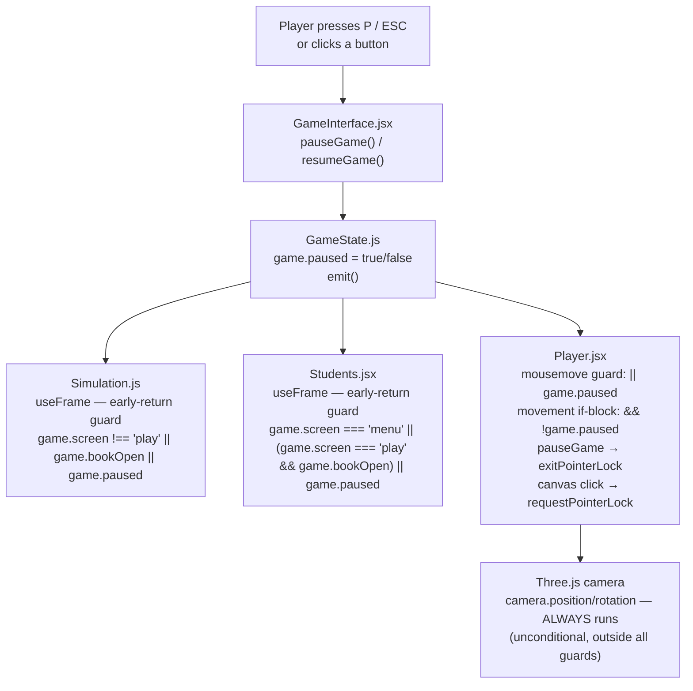

# Design Document

## Overview

The pause/resume system completes an already-started feature. `game.paused` exists on the `game` singleton and `GameInterface.jsx` already toggles it correctly, renders the pause overlay, and provides Resume / Restart / Main Menu buttons. What is missing is the enforcement: none of the three frame-driven subsystems (Simulation, Students, Player) read `game.paused`, so the game world keeps running behind the overlay.

The fix is intentionally minimal: add `paused: false` to the object returned by `fresh()` in `GameState.js`, add `|| game.paused` to the early-return guard in `Simulation.js` and `Students.jsx`, extend two guards in `Player.jsx` to suppress movement and mouse input, and add a `document.exitPointerLock?.()` call inside `pauseGame` in `GameInterface.jsx`. No new functions, no new files.

Requirement 6 (exact resume) requires no special handling. `useFrame` receives the inter-frame render delta — not wall-clock time — so when rendering resumes after a pause, `delta` is simply the first resumed frame's render time. `game.t` picks up from exactly where it left off.

---

## Architecture

The pause flag lives in the shared `game` singleton and flows outward to every subsystem that reads it.



React re-renders are triggered by `emit()` after every `game.paused` mutation. `useGame()` subscribers (including `GameInterface.jsx`) re-render and either show or hide the pause overlay.

---

## Components and Interfaces

### `src/systems/GameState.js` — two additions

**Addition 1: initialise `game.paused` in `fresh()`**

`fresh(T)` returns the reset object used by `startGame`. It does not currently include a `paused` field, so `game.paused` survives a restart. Add `paused: false` to the object returned by `fresh()`, placed at the end of the returned object after the `player` block:

```js
// inside fresh(T), at the end of the returned object:
paused: false
```

**Addition 2: explicitly reset `game.paused` in `startGame()`**

`startGame` merges `fresh(duration)` via `Object.assign`. Because `fresh()` now includes `paused: false`, the reset is automatic. No separate line in the override object is needed — the `fresh()` inclusion is sufficient. Because `fresh()` now returns `paused: false`, the `Object.assign` call in `startGame` resets it automatically. No additional change to the override object is required.

**Files Touched**

| File | Change |
|---|---|
| `src/systems/GameState.js` | Add `paused: false` to the object returned by `fresh()` |
| `src/systems/Simulation.js` | Add `\|\| game.paused` to the existing early-return guard |
| `src/characters/Students.jsx` | Add `\|\| game.paused` to the existing early-return guard |
| `src/classroom/Player.jsx` | Extend movement guard with `&& !game.paused`; extend mousemove guard with `\|\| game.paused` |
| `src/components/GameInterface.jsx` | Add `document.exitPointerLock?.()` inside `pauseGame` when `game.paused` becomes `true` |

---

### `src/systems/Simulation.js` — one-line guard change

**Current guard:**
```js
if (game.screen !== 'play' || game.bookOpen) return
```

**After change:**
```js
if (game.screen !== 'play' || game.bookOpen || game.paused) return
```

This single addition causes the entire `useFrame` body to be skipped while paused, covering:

- `game.t` advancement
- Bell scheduling
- Scheduled event queue processing (`game.queue`)
- Lighting restoration (`darkEnd` threshold check)
- Horror escalation (`fireAmbient`, `game.next` threshold)
- All Supernatural_Timer decrements (`clockRev`, `reflect`, `chairs`, `objects`, `sil`, `flick`)
- Clock reverse effect (`game.clockOff` mutation)
- Phantom student logic
- Empty chair consequence (`game.chairT`)
- Classroom paranoia (`game.paranoiaTimer`)
- Final bell check (`game.t >= game.T → endGame`)

Because the guard fires before any state mutation, all timers and counters freeze at their exact values and resume from those exact values on the first unpaused frame.

---

### `src/characters/Students.jsx` — one-line guard change

**Current guard:**
```js
if (game.screen === 'menu' || (game.screen === 'play' && game.bookOpen)) return
```

**After change:**
```js
if (game.screen === 'menu' || (game.screen === 'play' && game.bookOpen) || game.paused) return
```

This skips all per-student work while paused:

- `game.anim` accumulation (students hold their current animation frame)
- `updateStudent(s, dt, game.anim)` — movement, clue discovery, exposure, relationship changes
- `animateBody(s, dt, game.anim)` — posture, breathing, mouth expression
- `animateDeath(s, dt)` — death collapse and blood pool growth

Student positions, rotations, and animation state are plain JS object properties mutated in place by `updateStudent` and `animateBody`. Because neither function is called while paused, all values remain exactly as they were at the moment pause was triggered and are ready to continue on resume.

---

### `src/classroom/Player.jsx` — two guard changes + one pointer-lock call

#### (a) Movement guard — extend the if-block condition

**Current:**
```js
if (game.screen === 'play' && !game.bookOpen && game.t >= game.frozenUntil) {
  // WASD movement — mutates p.x, p.z
}
```

**After:**
```js
if (game.screen === 'play' && !game.bookOpen && !game.paused && game.t >= game.frozenUntil) {
  // WASD movement — mutates p.x, p.z
}
```

Movement inputs are discarded (keys.current still accumulates them, but they are never consumed), so they cannot be replayed on resume.

#### (b) Mousemove handler — add early return for paused state

**Current:**
```js
const move = e => {
  if (game.screen !== 'play' || game.bookOpen) return
  // mutates p.yaw, p.pitch
}
```

**After:**
```js
const move = e => {
  if (game.screen !== 'play' || game.bookOpen || game.paused) return
  // mutates p.yaw, p.pitch
}
```

Camera yaw and pitch are frozen at their values when pause was triggered.

#### (c) Camera update — stays unconditional

```js
// This block is OUTSIDE all guards and runs every frame regardless of pause state:
camera.position.set(p.x, 1.6, p.z)
camera.rotation.set(p.pitch, p.yaw, 0, 'YXZ')
```

The frozen scene continues to render behind the pause overlay on every frame.

---

### `src/components/GameInterface.jsx` — one pointer-lock call added to pauseGame

**Current:**
```js
const pauseGame = () => {
  if (game.screen !== 'play' || game.bookOpen) return
  game.paused = !game.paused
  emit()
}
```

**After:**
```js
const pauseGame = () => {
  if (game.screen !== 'play' || game.bookOpen) return
  game.paused = !game.paused
  if (game.paused) document.exitPointerLock?.()
  emit()
}
```

Releasing pointer lock when pausing makes the cursor visible so the player can click the overlay buttons. This matches the existing pattern in `toggleBook` and `endGame`.

On resume, `resumeGame` sets `game.paused = false` and calls `emit()`. The player must click the canvas to re-acquire pointer lock, which is the standard browser UX (pointer lock cannot be re-acquired without a user gesture on the canvas itself). The existing `mousedown` handler in `Player.jsx` already calls `el.requestPointerLock?.()` when the canvas is clicked and the game is in play state, so no additional code is needed for re-acquisition.

The remaining functions are already correct and require no changes:

- `resumeGame` — sets `game.paused = false`, calls `emit()`
- `restartGame` — calls `startGame(game.T)`, which resets all state via `fresh()` and sets `game.paused` to `false` through `Object.assign`
- `returnToMenu` — sets `game.paused = false`, `game.screen = 'menu'`, calls `emit()`
- Keyboard handler (`useEffect`) — already guards `game.bookOpen`, suppresses key-repeat, calls `preventDefault()`

---

## Data Models

One new field is added to the `fresh()` return value: `paused: false`. All other `game` fields involved (`game.paused` toggle, timer fields) already exist on the singleton.

For reference, the timer fields that freeze while paused and resume without adjustment:

| Field | Type | Behavior while paused |
|---|---|---|
| `game.t` | number (seconds elapsed) | No increment |
| `game.secs` | number (countdown display) | No decrement |
| `game.clockRev` | countdown timer | No decrement |
| `game.reflect` | countdown timer | No decrement |
| `game.chairs` | countdown timer | No decrement |
| `game.objects` | countdown timer | No decrement |
| `game.sil` | countdown timer | No decrement |
| `game.flick` | countdown timer | No decrement |
| `game.darkEnd` | timestamp threshold | Not evaluated |
| `game.frozenUntil` | timestamp threshold | Not evaluated |
| `game.paranoiaTimer` | timestamp threshold | Not evaluated |
| `game.next` | timestamp threshold | Not evaluated |
| `game.anim` | animation accumulator | No increment |

All of these are plain number fields mutated in `Simulation.js`'s `useFrame` body, which is entirely skipped when `game.paused` is true.

---

## Correctness Properties

*A property is a characteristic or behavior that should hold true across all valid executions of a system — essentially, a formal statement about what the system should do. Properties serve as the bridge between human-readable specifications and machine-verifiable correctness guarantees.*

### Property 1: Game timer accuracy across pause/resume sequences

*For any* sequence of frame deltas interleaved with pause and resume events, `game.t` after processing all frames must equal the sum of only those deltas that arrived while `game.paused` was `false`, within a tolerance of 1 ms.

**Validates: Requirements 1.3, 6.1, 6.4**

---

### Property 2: Student state is preserved across freeze and unfreeze

*For any* set of student states (position, rotation, animation accumulator, clue/exposure/relationship values), after any number of simulated frames while `game.paused` is `true` followed by setting `game.paused` to `false`, each student's state must be bitwise-identical to its state at the moment `game.paused` became `true`.

**Validates: Requirements 2.1, 2.2, 2.3, 2.5**

---

### Property 3: Camera always reflects stored player values

*For any* value of `game.player.x`, `game.player.z`, `game.player.yaw`, and `game.player.pitch`, and regardless of the value of `game.paused`, the Three.js camera's world position and rotation after a `useFrame` tick must equal `(game.player.x, 1.6, game.player.z)` and `(game.player.pitch, game.player.yaw, 0)` respectively.

**Validates: Requirements 3.5**

---

## Error Handling

**`game.paused` is set while `game.bookOpen` is `true`**: `pauseGame` guards against this — it returns early if `game.bookOpen` is true. The keyboard handler has the same guard. No overlap between the notebook overlay and the pause overlay is possible through the existing entry points.

**`startGame` is called while paused (Restart button)**: `startGame` merges `fresh(duration)` via `Object.assign`. Because `fresh()` now includes `paused: false`, restarting always produces an unpaused session. No special handling is required.

**Pointer lock re-acquisition on resume**: Browsers require a direct user gesture to acquire pointer lock. The player must click the canvas after resuming, which triggers the existing `mousedown` handler that calls `el.requestPointerLock?.()`. No special error handling is needed; the game is fully playable with mouse drag (non-locked mode) until the player clicks.

---

## Testing Strategy

No test runner is configured in `package.json` for this project (scripts are `dev`, `build`, `preview` only). The tests below are manual browser console checks that verify the pause guard additions in isolation.

1. **Simulation freeze** — Set `game.paused = true`, call the Simulation `useFrame` callback with a fixed delta (e.g. `0.016`), then log `game.t`, all Supernatural_Timer fields, and `game.queue`. Assert none of these values changed from their pre-call snapshot.

2. **Student freeze** — Set `game.paused = true`, call the Students `useFrame` callback, then compare each student's `x`, `z`, `yaw`, and animation-dependent fields against a snapshot taken before the call. Assert all values are identical.

3. **Player movement freeze** — Set `game.paused = true` and populate `keys.current` with `{ KeyW: true }`. Call the Player `useFrame` callback. Assert `game.player.x` and `game.player.z` are unchanged.

4. **Mouse freeze** — Set `game.paused = true`, then dispatch a `mousemove` event on `window` with `movementX: 50` and `movementY: 50`. Assert `game.player.yaw` and `game.player.pitch` are unchanged.

5. **Pointer lock on pause** — Replace `document.exitPointerLock` with a spy, call `pauseGame()` while `game.screen === 'play'` and `game.bookOpen === false`, and assert the spy was called.

6. **Keyboard shortcuts** — Dispatch `keydown` for `KeyP` while `game.screen === 'play'`; assert `game.paused` toggles to `true`. Dispatch again with `repeat: true`; assert `game.paused` does not toggle again. Dispatch `Escape`; assert `game.paused` toggles back to `false`.

7. **Restart clears pause** — Set `game.paused = true`, then call `startGame(game.T)`. Assert `game.paused` is `false` immediately after the call.
